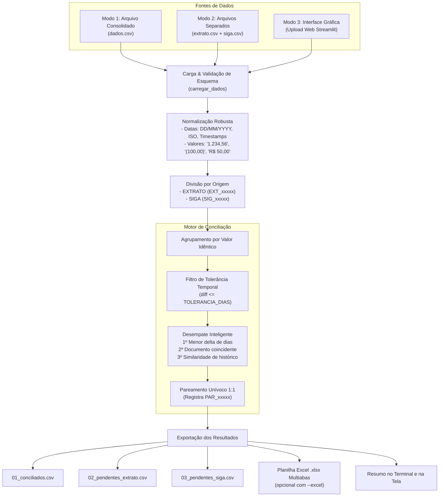

# Conciliação Financeira (EXTRATO x SIGA)

Sistema em Python de alta performance para conciliação contábil e financeira automatizada entre lançamentos bancários (**EXTRATO**) e registros do sistema de gestão interno (**SIGA**).

Disponível tanto via **Interface Gráfica Interativa (Web/Desktop)** quanto via **Linha de Comando (CLI)** e scripts automatizados em lote.

---

## 📋 Sumário
1. [Visão Geral](#-visão-geral)
2. [Interface Gráfica (Streamlit)](#-interface-gráfica-streamlit)
3. [Arquitetura e Fluxo de Processamento](#-arquitetura-e-fluxo-de-processamento)
4. [Estrutura do Repositório](#-estrutura-do-repositório)
5. [Pré-requisitos e Instalação](#-pré-requisitos-e-instalação)
6. [Especificação dos Dados de Entrada](#-especificação-dos-dados-de-entrada)
7. [Regras de Negócio e Algoritmo Avançado](#-regras-de-negócio-e-algoritmo-avançado)
8. [Relatórios Gerados e Saídas (CSV e Excel)](#-relatórios-gerados-e-saídas-csv-e-excel)
9. [Como Executar via Linha de Comando (CLI)](#-como-executar-via-linha-de-comando-cli)
10. [Opções de Linha de Comando (CLI)](#-opções-de-linha-de-comando-cli)
11. [Testes Automatizados](#-testes-automatizados)
12. [Diagnóstico e Solução de Problemas (Troubleshooting)](#-diagnóstico-e-solução-de-problemas-troubleshooting)

---

## 🎯 Visão Geral

A aplicação tem por objetivo cruzar os dados de movimentações financeiras de duas fontes distintas:
- **EXTRATO**: Lançamentos consolidados no extrato bancário da conta corrente.
- **SIGA**: Lançamentos efetuados no sistema de gestão/contabilidade.

O sistema suporta tanto a leitura de um **arquivo único consolidado** (`dados.csv` contendo coluna de origem) quanto a leitura direta de **dois arquivos independentes** (`extrato.csv` e `siga.csv`).

O algoritmo identifica correspondências com base em **valores monetários idênticos**, priorizando pares com **menor distância temporal (dias)** e aplicando **desempate inteligente** por número de documento e similaridade textual no histórico. As movimentações sem paridade são devidamente segregadas em relatórios de pendências para conferência contábil.

---

## 🖥️ Interface Gráfica (Streamlit)

A aplicação conta com uma interface gráfica web moderna e interativa que dispensa o uso de comandos no terminal.

### Como Iniciar a Interface
Execute um dos comandos abaixo na raiz do projeto:

```bash
# Opção 1: Via script de inicialização rápida
./run_gui.sh

# Opção 2: Diretamente via Streamlit
streamlit run app.py
```

A interface abrirá automaticamente no seu navegador. Caso não abra, acesse no Google Chrome ou Edge:
👉 **`http://localhost:8501`**

```text
┌────────────────────────────────────────────────────────────────────────────────────────┐
│  ⚖️ Conciliação Financeira (EXTRATO x SIGA)                                            │
├────────────────────────────────────────────────────────────────────────────────────────┤
│  [⚙️ Configurações Lateral]      [📂 1. Upload de Arquivos]                            │
│  • Tolerância de dias           • Aba 'Dois Arquivos': Extrato (CSV) e SIGA (CSV)      │
│  • Separador (| ou ;)            • Aba 'Arquivo Único': dados.csv                      │
│  • Codificação (utf-8 / latin1)  • Botão 'Carregar Exemplo Prático'                    │
├────────────────────────────────────────────────────────────────────────────────────────┤
│  [📊 2. Cartões de Métricas]                                                          │
│  Total EXTRATO      Total SIGA        Conciliado        Pendentes EXT   Pendentes SIGA │
│  R$ 1.865,50        R$ 2.710,50       R$ 1.820,50       R$ 45,00        R$ 890,00      │
├────────────────────────────────────────────────────────────────────────────────────────┤
│  [📋 3. Tabelas Interativas]                                                           │
│  [✅ Conciliados (2)]      [⚠️ Pendentes Extrato (1)]      [⚠️ Pendentes SIGA (1)]      │
├────────────────────────────────────────────────────────────────────────────────────────┤
│  [📥 4. Botões de Download]                                                            │
│  [📊 Baixar Excel Completo (.xlsx)]  [01_conciliados.csv]  [02_pend.csv]  [03_pend.csv]│
└────────────────────────────────────────────────────────────────────────────────────────┘
```

### Principais Recursos da Interface:
- **Arrastar e Soltar (Drag & Drop):** Envie os arquivos do Extrato e do SIGA facilmente.
- **Teste Rápido com 1 Clique:** Aba para carregar instantaneamente o arquivo `dados.exemplo.csv`.
- **Ajuste de Parâmetros Visual:** Slider de tolerância temporal e seletores de delimitador e codificação.
- **Tabelas com Busca e Ordenação:** Navegue pelos registros conciliados e pendências diretamente na tela.
- **Download Imediato:** Baixe a planilha consolidada em Excel multiabas (`.xlsx`) ou os CSVs individuais.

---

## 🏗 Arquitetura e Fluxo de Processamento



---

## 📂 Estrutura do Repositório

```text
conciliation/
│
├── app.py                    # Aplicação da Interface Gráfica Web (Streamlit)
├── run_gui.sh                # Script executável para iniciar a interface gráfica
├── conciliar.py              # Motor principal de conciliação e CLI
├── start.sh                  # Script auxiliar para cópia de arquivos e execução
├── send.sh                   # Script auxiliar para envio dos resultados
├── requirements.txt          # Dependências da aplicação (pandas, openpyxl, streamlit)
├── dados.exemplo.csv         # Amostra sintética de dados para teste e validação
├── tests/
│   └── test_conciliacao.py   # Suíte de testes unitários automatizados
└── README.md                 # Documentação técnica e operacional
```

---

## ⚙️ Pré-requisitos e Instalação

### Requisitos
- **Python 3.8** ou superior.
- Bibliotecas **Pandas** (>= 2.0.0), **openpyxl** (>= 3.1.0) e **Streamlit** (>= 1.30.0).
- Sistema operacional Linux, macOS ou Windows (com WSL).

### Passo a Passo de Instalação

1. **Acesse a pasta do projeto:**
   ```bash
   cd /home/sidnei/dev/conciliation
   ```

2. **Crie e ative um ambiente virtual:**
   ```bash
   python3 -m venv venv
   source venv/bin/activate
   ```

3. **Instale as dependências:**
   ```bash
   pip install -r requirements.txt
   ```

---

## 📄 Especificação dos Dados de Entrada

A ferramenta suporta duas modalidades de entrada:

### Modalidade 1: Arquivo Único Consolidado (`dados.csv`)
O arquivo contém todos os lançamentos juntos, diferenciados pela coluna `Origem`.

| Coluna | Obrigatória? | Formato / Exemplo | Descrição |
| :--- | :--- | :--- | :--- |
| `Origem` | **Sim** | `EXTRATO` ou `SIGA` | Identifica a procedência do lançamento. |
| `Data` | **Sim** | `DD/MM/YYYY` ou `YYYY-MM-DD` | Data contábil/efetiva do lançamento. |
| `Valor` | **Sim** | `1.234,56`, `(100,00)`, `R$ 50,00` | Valor monetário (suporta notação contábil negativa). |
| `Historico` | Opcional | `TED FORNECEDOR ABC` | Descrição ou histórico do lançamento. |
| `Documento` | Opcional | `DOC1001` | Número do documento/comprovante. |
| `Status` | Opcional | `COMPENSADO`, `LIQUIDADO` | Status operacional original. |

### Modalidade 2: Dois Arquivos Separados (`extrato.csv` e `siga.csv`)
Caso prefira não juntar os arquivos manualmente, passe os arquivos separadamente via `--extrato` e `--siga` (ou envie-os pelas caixas separadas na interface gráfica). A coluna `Origem` é atribuída automaticamente para cada base.

### Exemplo de Entrada (`dados.exemplo.csv`)
```csv
Data|Valor|Origem|Historico|Documento|Status
01/08/2026|1.500,00|EXTRATO|TED RECEBIDA CLIENTE A|DOC1001|COMPENSADO
01/08/2026|1.500,00|SIGA|RECEBIMENTO NOTA 5430|DOC1001|LIQUIDADO
02/08/2026|320,50|EXTRATO|PAGAMENTO PIX FORNECEDOR B|DOC2002|COMPENSADO
04/08/2026|320,50|SIGA|PAGAMENTO FORNECEDOR B|DOC2002|LIQUIDADO
05/08/2026|45,00|EXTRATO|TARIFA BANCARIA PACOTE|DOC3003|DEBITADO
06/08/2026|890,00|SIGA|LANCAMENTO MANUAL A REGULARIZAR|DOC4004|ABERTO
```

---

## 🧠 Regras de Negócio e Algoritmo Avançado

1. **Normalização Resiliente:**
   - **Valores (`parse_valor`):** Aceita formato brasileiro (`1.234,56`), notação contábil negativa com parênteses `(350,00)`, sinais negativos explícitos (`- 120,00` ou `120,00-`), símbolos de moeda (`R$`) e espaços extras. Valores são arredondados para 2 casas decimais.
   - **Datas (`parse_data`):** Aceita múltiplos formatos (`DD/MM/YYYY`, `YYYY-MM-DD`, registros com horas) e normaliza para a data truncada (sem horas residuais) garantindo cálculo exato de dias.

2. **Hierarquia de Pareamento de Candidatos:**
   Para lançamentos de mesmo valor monetário dentro do limite `TOLERANCIA_DIAS`, os pares candidatos são priorizados pelos seguintes critérios:
   1. **Diferença de Dias ($\Delta\text{dias}$):** Menor diferença temporal absoluta tem prioridade máxima.
   2. **Coincidência de Documento:** Se o campo `Documento` estiver preenchido e for idêntico em ambas as bases, o par ganha prioridade imediata sobre pares com documento divergente.
   3. **Similaridade de Histórico:** Em caso de empate em data e documento, o algoritmo calcula a similaridade textual (`difflib`) entre as descrições e prioriza os textos mais similares.

3. **Unicidade de Pareamento (1:1):**
   Garante que nenhum registro seja utilizado em mais de um par conciliado. Os registros não aproveitados são automaticamente direcionados às pendências.

---

## 📊 Relatórios Gerados e Saídas (CSV e Excel)

### 1. Arquivos CSV (Padrão Excel Brasil)
Gerados com codificação `utf-8-sig` (com BOM), delimitador `;` e vírgula como separador decimal:
- `01_conciliados.csv`: Registros casados com sucesso, contendo dados de ambas as fontes, delta de dias e status.
- `02_pendentes_extrato.csv`: Movimentações bancárias sem contrapartida no SIGA.
- `03_pendentes_siga.csv`: Movimentações no SIGA sem contrapartida no banco.

### 2. Pasta de Trabalho Excel Consolidada (`.xlsx`)
Ao informar a flag `--excel relatorio.xlsx` (ou via botão de download na interface gráfica), o sistema gera uma única planilha com 4 abas estruturadas:
- **`Resumo`**: Tabela com totalizadores, quantidades, valores e diferença líquida.
- **`Conciliados`**: Base completa de pares formados.
- **`Pendentes_Extrato`**: Detalhes dos lançamentos pendentes no extrato.
- **`Pendentes_SIGA`**: Detalhes dos lançamentos pendentes no SIGA.

### 3. Sumário no Terminal
```text
============================================================
RESUMO DA CONCILIAÇÃO
============================================================
Total EXTRATO        : R$        1.865,50  (3 regs)
Total SIGA           : R$        2.710,50  (3 regs)
------------------------------------------------------------
Conciliado           : R$        1.820,50  (2 pares)
Pendente no EXTRATO  : R$           45,00  (1 regs)
Pendente no SIGA     : R$          890,00  (1 regs)
------------------------------------------------------------
Diferença geral      : R$          845,00
============================================================
```

---

## 🚀 Como Executar via Linha de Comando (CLI)

### Execução Direta via Python

```bash
# 1. Modo padrão (procura dados.csv ou extrato.csv + siga.csv automaticamente):
python3 conciliar.py

# 2. Informando arquivo consolidado e gerando Excel:
python3 conciliar.py dados.csv --excel conciliacao_resultado.xlsx

# 3. Informando dois arquivos separados com tolerância de 5 dias:
python3 conciliar.py --extrato extrato.csv --siga siga.csv --tolerancia 5 --excel resultado.xlsx

# 4. Customizando separador e codificação:
python3 conciliar.py dados.csv --sep ";" --encoding "latin1"
```

### Fluxo Automatizado com Windows / WSL (`start.sh` e `send.sh`)

Os scripts em Bash aceitam a competência (mês/ano) como parâmetro opcional (padrão: `08-2026`):

1. **Iniciar Conciliação:**
   ```bash
   # Executa para competência padrão (08-2026):
   ./start.sh

   # Ou informando outra competência:
   ./start.sh 09-2026
   ```

2. **Enviar Resultados para o Windows:**
   ```bash
   ./send.sh 09-2026
   ```

---

## 💻 Opções de Linha de Comando (CLI)

Visualize as opções a qualquer momento executando `python3 conciliar.py --help`:

| Argumento | Padrão | Descrição |
| :--- | :--- | :--- |
| `arquivo` | `None` / `dados.csv` | Caminho do arquivo consolidado de entrada. |
| `--extrato` | `None` | Caminho do arquivo do EXTRATO (usado com `--siga`). |
| `--siga` | `None` | Caminho do arquivo do SIGA (usado com `--extrato`). |
| `--tolerancia` | `9999` | Diferença máxima permitida em dias para parear lançamentos. |
| `--sep` | `\|` | Delimitador de colunas dos arquivos de entrada. |
| `--encoding` | `utf-8` | Codificação dos arquivos (`utf-8`, `latin1`, etc.). |
| `--excel` | `None` | Gera pasta de trabalho Excel consolidada (`.xlsx`) com abas. |
| `--prefixo-saida` | `""` | Prefixo customizado nos nomes dos CSVs gerados. |

---

## 🧪 Testes Automatizados

O projeto conta com uma suíte de testes unitários cobrindo parsing de valores, tolerância contábil, similaridade de texto, argumentos de linha de comando e lógica de conciliação.

Para rodar os testes:
```bash
python3 -m unittest discover -s tests
```

---

## 🔍 Diagnóstico e Solução de Problemas (Troubleshooting)

### 1. `UnicodeDecodeError: 'utf-8' codec can't decode byte...`
- **Causa:** O arquivo CSV foi gerado em codificação legada do Windows (ANSI/Latin-1).
- **Solução:** Na interface gráfica, mude o seletor de codificação para `latin1`. No terminal, use `--encoding latin1`.

### 2. `Colunas obrigatórias ausentes na base: [...]`
- **Causa:** O arquivo de entrada não possui os cabeçalhos obrigatórios (`Data`, `Valor`, `Origem`).
- **Solução:** Verifique a primeira linha do arquivo ou use a aba de "Dois Arquivos" para extrato e SIGA separados.

### 3. Interface gráfica não abre automaticamente
- **Causa:** No WSL ou Linux headless, o navegador do sistema pode não abrir a janela sozinho.
- **Solução:** Abra o navegador manualmente no Windows ou Linux e acesse o endereço `http://localhost:8501`.
